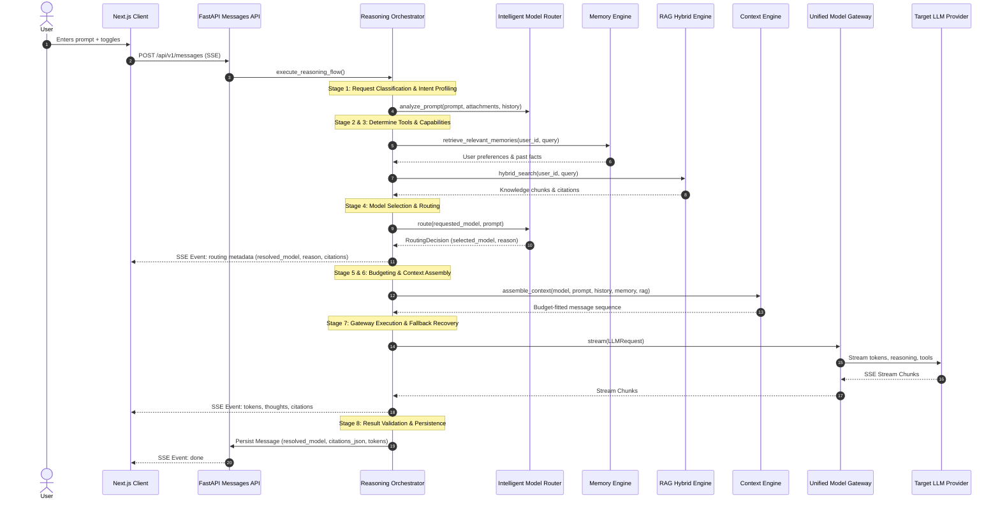
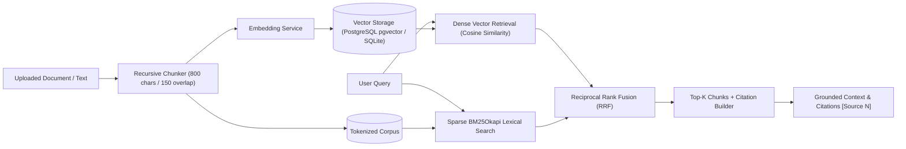
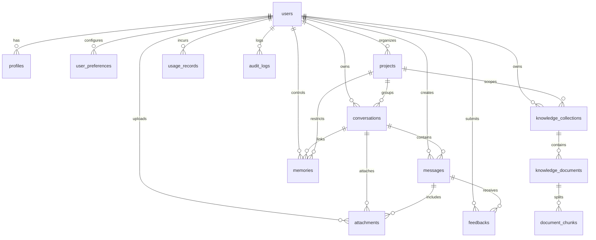

# NEXORA AI – Master System Architecture (Prompt 2: Intelligence Engine)

## 1. High-Level System Architecture

```mermaid
flowchart TD
    subgraph Client ["Frontend Client (Next.js 14 App Router)"]
        UI["Chat Interface (Tailwind CSS)"]
        Composer["Chat Composer & Dynamic Model Selector"]
        Sidebar["Conversation History & Search"]
        AuthHook["useAuth & useChat Hooks"]
        SSEConsumer["SSE Stream Reader (Fetch API)"]
    end

    subgraph Backend ["FastAPI Core Application"]
        Router["API v1 Consolidated Router (/api/v1)"]
        Auth["JWT & Multi-Tenant Security"]
        Orchestrator["8-Stage Reasoning Orchestrator"]
        ModelRouter["Intelligent Model Router"]
        ModelRegistry["Centralized Model Registry"]
        Gateway["Unified Model Gateway"]
        MemoryEngine["Memory Engine (Semantic Vector)"]
        RAGEngine["Hybrid RAG Engine (BM25 + Vector + RRF)"]
        ContextEngine["Context Window & Token Budget Engine"]
        SearchSvc["Web Grounding Search Service"]
    end

    subgraph Data ["Persistence & Vector Layer"]
        Postgres[(PostgreSQL 16 / Async SQLite)]
        pgvector[(pgvector Embeddings Index)]
        Redis[(Redis 7 Cache & Sessions)]
        Storage[(Local / S3 Attachment Storage)]
    end

    subgraph AIProviders ["Unified Gateway Adapters"]
        GoogleAdapter["Google Gemini 1.5 Pro / Flash"]
        OpenAIAdapter["OpenAI GPT-4o / GPT-4o-mini"]
        AnthropicAdapter["Anthropic Claude 3.5 Sonnet / Haiku"]
        HFAdapter["Hugging Face Inference (Llama 3.1 70B, DeepSeek)"]
        SelfHostedAdapter["OpenAI-Compatible (Ollama, vLLM, LM Studio)"]
        NexoraAdapter["NEXORA Proprietary Flagship & Fallback Engine"]
    end

    UI --> AuthHook
    Composer --> SSEConsumer
    Sidebar --> AuthHook

    AuthHook --> Router
    SSEConsumer -->|SSE Stream POST| Router

    Router --> Auth
    Auth --> Orchestrator
    Orchestrator --> ModelRouter
    ModelRouter --> ModelRegistry
    Orchestrator --> MemoryEngine
    Orchestrator --> RAGEngine
    Orchestrator --> ContextEngine
    Orchestrator --> SearchSvc
    Orchestrator --> Gateway

    Gateway --> GoogleAdapter
    Gateway --> OpenAIAdapter
    Gateway --> AnthropicAdapter
    Gateway --> HFAdapter
    Gateway --> SelfHostedAdapter
    Gateway --> NexoraAdapter

    MemoryEngine --> Postgres
    RAGEngine --> Postgres
    MemoryEngine --> pgvector
    RAGEngine --> pgvector
    Auth --> Redis
```

---

## 2. The 8-Stage Advanced Reasoning Framework

---

## 3. Unified Model Gateway Architecture

All AI providers adhere to a unified internal protocol defined in `backend/app/services/llm/base.py`:
- **Common Request Interface**: `LLMRequest` supports `messages`, `model`, `temperature`, `max_tokens`, `tools`, `response_format`, `reasoning_mode`, and timeouts.
- **Common Stream Interface**: `LLMStreamChunk` streams `type` (`token`, `reasoning`, `tool_call`, `usage`, `done`, `error`), with `resolved_model`, `routing_reason`, and `citations`.
- **Supported Adapters**:
  1. `GeminiProvider`: Streaming, Function Calling declarations, JSON response schema, token accounting, retries with exponential backoff.
  2. `OpenAIProvider`: Streaming, Tool Calling, Structured Outputs (`json_schema`), o-series reasoning tokens, cost tracking.
  3. `AnthropicProvider`: Streaming, Claude tool definitions, input/output token usage, cost tracking.
  4. `HuggingFaceProvider`: Serverless Inference API and Dedicated Endpoints for open-weights models (Llama 3.1 70B, DeepSeek-R1).
  5. `OpenAICompatibleProvider`: Self-hosted local inference endpoints (Ollama, vLLM, LM Studio, LocalAI).
  6. `NexoraProvider`: Proprietary multi-turn reasoning engine and offline local resilience fallback.
- **Provider Resilience & Failover**: Automatic cascaded failover to local engine if an upstream provider key is missing, rate-limited, or offline.
- **Provider Health Checks**: Concurrently monitored via `/api/v1/gateway/health`.

---

## 4. Centralized Model Registry

Model specifications, capabilities, and pricing are registered centrally in `ModelRegistry`:

| Model ID | Provider | Context Window | Max Output | Modalities | Capabilities | Pricing (In/Out per 1M) |
| :--- | :--- | :--- | :--- | :--- | :--- | :--- |
| `nexora-auto` | `nexora` | 2,000,000 | 8,192 | Text, Vision | Auto Routing, Tools, Reasoning | Dynamic |
| `nexora-flagship` | `nexora` | 128,000 | 8,192 | Text, Vision | Reasoning, Tools, Code, JSON | $1.50 / $6.00 |
| `nexora-fast` | `nexora` | 64,000 | 4,096 | Text | Low-Latency, Tools, JSON | $0.10 / $0.40 |
| `gemini-1.5-pro` | `google` | 2,000,000 | 8,192 | Text, Vision | Deep Reasoning, 2M Context, Tools | $1.25 / $5.00 |
| `gemini-1.5-flash` | `google` | 1,000,000 | 8,192 | Text, Vision | Fast Multimodal, 1M Context, Tools | $0.075 / $0.30 |
| `gpt-4o` | `openai` | 128,000 | 4,096 | Text, Vision | Multimodal Flagship, Tools, JSON | $2.50 / $10.00 |
| `gpt-4o-mini` | `openai` | 128,000 | 4,096 | Text, Vision | Lightweight Fast, Tools, JSON | $0.15 / $0.60 |
| `claude-3-5-sonnet`| `anthropic`| 200,000 | 8,192 | Text, Vision | Coding Specialist, Reasoning, Tools | $3.00 / $15.00 |
| `hf-llama-3-70b` | `huggingface`| 128,000 | 4,096 | Text | Open Weights, Tools, JSON | $0.70 / $0.90 |
| `ollama-local` | `self_hosted`| 32,000 | 4,096 | Text | Private Local Inference | $0.00 / $0.00 |

---

## 5. Memory Engine Architecture

The Memory Engine maintains short-term, long-term, and project semantic memory:
- **Vector Embeddings**: Normalized vector representations generated via pluggable `EmbeddingService` (OpenAI, Gemini, or local vector generator).
- **Semantic Retrieval**: Cosine similarity retrieval filtered strictly by `user_id == current_user.id`.
- **Duplicate Detection**: Computes semantic similarity against existing user memories before insertion. If similarity $\ge 0.88$, it updates the existing memory (reinforces confidence, updates timestamp and content) rather than creating duplicates.
- **User Permission & Control**: Endpoints allow inspecting, searching, and deleting memories with user consent.

---

## 6. RAG Engine (Hybrid Search & RRF Reranking)

**Reciprocal Rank Fusion (RRF) Formula:**
$$RRF(d) = \frac{\alpha}{60 + \text{rank}_{\text{dense}}(d)} + \frac{1 - \alpha}{60 + \text{rank}_{\text{sparse}}(d)}$$

---

## 7. Context Engine & Token Budgeting

The Context Engine prevents context window overflow and ensures optimal prompt compression:
- **Exact Token Counting**: Powered by `tiktoken` (o200k_base / cl100k_base) with heuristic fallback.
- **Budget Partitioning**:
  $$\text{Available Input} = \text{ModelContextWindow} - \text{MaxOutputTokens} - 1000$$
  - System Instructions: Reserved first.
  - RAG Context: Up to 25% of input budget.
  - User Memory: Up to 10% of input budget.
  - Message History: Remaining budget.
- **Conversation Compression**: When history exceeds budget, older turns are summarized into an executive summary block while preserving recent dialogue turns verbatim.

---

## 8. Relational Data Model (15 Tables)

