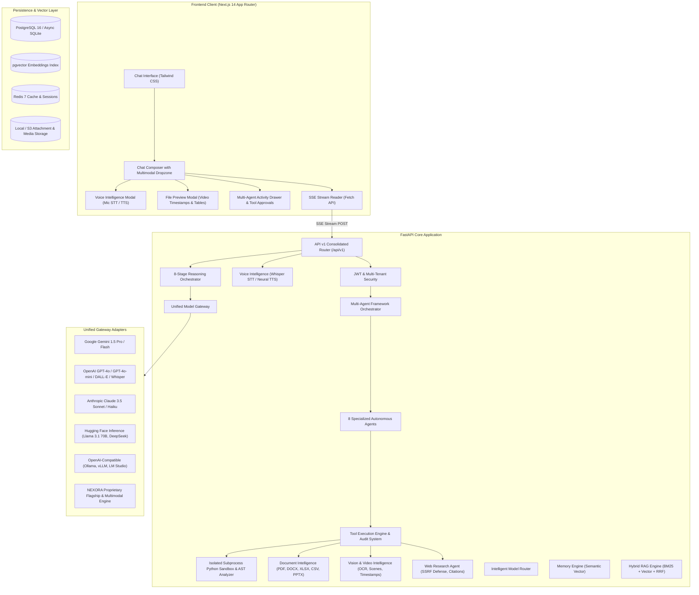

# NEXORA AI – Master System Architecture (Prompt 3: Multimodal & Agentic Intelligence)

## 1. High-Level System Architecture

## 2. Multimodal Intelligence Architecture

### 2.1 Image Intelligence (`image_service.py`)
- **Metadata Extraction**: Inspects image formats, aspect ratios, color modes, and resolution using Pillow.
- **Vision Pipeline**: Direct base64 data URI injection into the LLM Gateway (`LLMMessage.images`).
- **Specialized Task Prompts**:
  - `ocr`: Verbatim text extraction preserving columns and numbers.
  - `chart`: Reads X/Y axes, data trends, legends, and outputs Markdown tables.
  - `diagram`: Architecture topology and flowchart relationship mapping.
  - `screenshot`: Identifies UI layouts, buttons, forms, and error states.
- **Image Generation & Editing**: DALL-E 3 integration with offline SVG generative fallback.

### 2.2 Video Intelligence (`video_service.py`)
- **Container Parsing**: Estimates video bitrates, durations, and file sizes.
- **Scene Segmentation**: Generates structured timestamp scene markers formatted as `[MM:SS]`.
- **Async Media Jobs**: Dedicated `media_jobs` table and FastAPI background tasks for long video analysis.

### 2.3 Document Intelligence (`document_service.py`)
- **Supported Formats**: PDF (`pypdf`), DOCX (`python-docx`), XLSX (`openpyxl`), CSV (Python `csv`), PPTX (`python-pptx`), TXT, and JSON.
- **Table Extraction**: Extracts tabular data structures and generates GitHub-flavored Markdown tables.
- **Comparative Analysis**: Compares two documents side-by-side on vocabulary overlap, unique terms, and metric differences.
- **RAG Ingestion**: Connects parsed document chunks directly into the Hybrid RAG index.

### 2.4 Voice Intelligence (`voice_service.py`)
- **Speech-to-Text (STT)**: Transcribes audio files via OpenAI Whisper API adapter or built-in speech engine.
- **Text-to-Speech (TTS)**: Synthesizes high-fidelity voice audio via OpenAI TTS or generates valid PCM/WAV binary streams.
- **Audio Summarization**: Extracts bulleted insights and actionable follow-ups from transcripts.

## 3. Web Research Agent & Security (`research_service.py`, `sandbox.py`)

### 3.1 Strict SSRF Protection (`SSRFValidator`)
All outbound HTTP requests are validated against private/internal IP address spaces:
- Loopback (`127.0.0.0/8`, `::1/128`)
- RFC 1918 Private Subnets (`10.0.0.0/8`, `172.16.0.0/12`, `192.168.0.0/16`)
- Cloud Instance Metadata (`169.254.0.0/16`, `metadata.google.internal`)
- Non-HTTP schemes (`file://`, `ftp://`, `gopher://`)
- DNS rebinding mitigation with strict socket timeout bounds.

### 3.2 Prompt Injection Neutralization
Incoming web content is scrubbed through regex sanitizers to neutralize prompt injection directives (e.g. `ignore previous instructions`, `system prompt override`).

### 3.3 Verified Citations
Every statement is backed by verifiable web search hits; fabricated URLs or hallucinated sources are strictly prevented.

## 4. Multi-Agent Framework (`backend/app/services/agents/`)

The framework deploys 8 specialized autonomous agents coordinated by a central orchestrator:
1. **ORCHESTRATOR**: Analyzes user intent, builds multi-step execution plans, dispatches sub-agents, and synthesizes answers.
2. **RESEARCH AGENT**: Conducts deep web and literature research, compares sources, and generates cited reports.
3. **CODING AGENT**: Writes, reviews, debugs, and benchmarks code; executes tests in the sandbox.
4. **DATA ANALYSIS AGENT**: Processes structured tabular datasets, computes summary statistics, and configures charts.
5. **DOCUMENT AGENT**: Analyzes, parses, and compares multi-format documents.
6. **BROWSER AGENT**: Interacts with authorized external web resources under strict SSRF defense.
7. **VISION AGENT**: Understands images, OCR, charts, diagrams, and software screenshots.
8. **PERSONAL ASSISTANT AGENT**: Coordinates general user tasks, schedules, and conversational productivity.

## 5. Tool Execution Engine & Secure Sandbox (`backend/app/services/tools/`)

### 5.1 Standardized Tool Architecture
Every tool defines:
- `tool_id`: Unique string identifier.
- `name` & `description`: Function-calling metadata.
- `input_schema` & `output_schema`: JSON schema definitions.
- `permission_level`: Classified into `READ`, `ANALYZE`, `PREPARE`, `EXECUTE`.
- `timeout_seconds`: Execution deadline.
- `requires_approval`: Flag for sensitive execution actions.

### 5.2 Isolated Python Sandbox
- **AST Static Analysis (`CodeASTAnalyzer`)**: Blocks dangerous modules (`os`, `subprocess`, `socket`, `ctypes`, `pty`, `multiprocessing`) and calls (`eval`, `exec`, `__import__`).
- **Subprocess Isolation**: Runs with `python -I` in a temporary workspace with stripped environment variables (no access to `SECRET_KEY`, database credentials, or AI provider keys).

## 6. Database Migrations
- `001_initial_schema.py`: Core tables (Users, Profiles, Conversations, Messages, Attachments, Projects, Preferences, Models, Usage, Feedback, Audits).
- `002_intelligence_engine.py`: Memories, Knowledge Collections, Documents, Chunks, and Vector Indices.
- `003_multimodal_agents.py`: Agent Workflows (`agent_workflows`), Agent Steps (`agent_steps`), Tool Executions (`tool_executions`), and Media Jobs (`media_jobs`).
