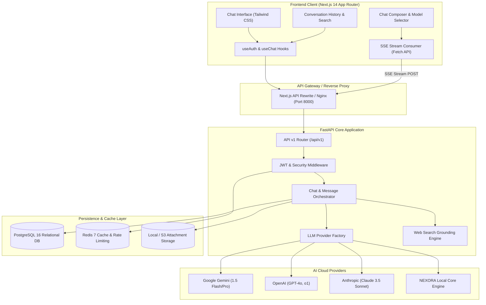
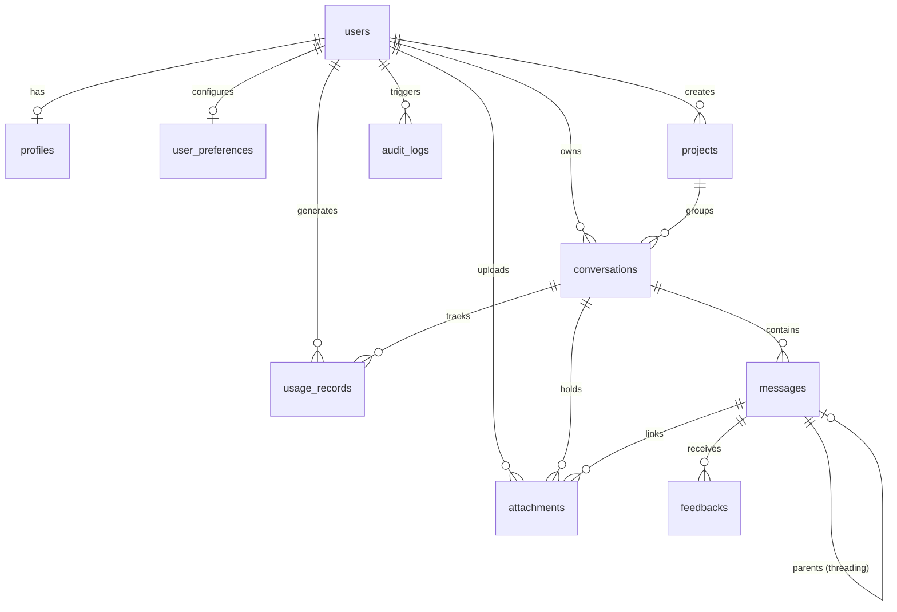

# NEXORA AI – Master System Architecture

## 1. High-Level System Architecture

---

## 2. Database Schema (Entity-Relationship)

The database schema comprises **11 relational tables** managed through SQLAlchemy 2.0 and version-controlled via Alembic migrations:

1. **`users`**: User identities, authentication hashes, active status, verification tokens, roles.
2. **`profiles`**: User profiles with display name, avatar, bio, timezone, and language.
3. **`user_preferences`**: User-specific configuration (theme, default model, streaming behavior, enter-to-send).
4. **`conversations`**: Chat thread sessions, titles, pinned status, archive status, model IDs, system prompts, reasoning flags.
5. **`messages`**: Multi-turn chat messages, roles (`user`, `assistant`, `system`), reasoning content, token counts, edit status.
6. **`attachments`**: Uploaded file metadata, storage paths, file sizes, mime types linked to messages and conversations.
7. **`projects`**: Workspace projects allowing custom contextual instructions.
8. **`model_configurations`**: Catalog of AI models, context window limits, max output tokens, vision and reasoning capabilities.
9. **`usage_records`**: Granular token metrics (prompt tokens, completion tokens, latency ms) per interaction.
10. **`feedbacks`**: Thumbs up / down feedback, quality ratings, and optional user comments.
11. **`audit_logs`**: Security and activity auditing (logins, logouts, resource modifications, IP address, user agent).

---

## 3. Streaming & Event Lifecycle

1. **User Request**: The user submits a prompt via `ChatComposer`.
2. **Immediate UI Optimism**: The user message and an assistant placeholder message are rendered instantly in the UI with a glowing thinking indicator.
3. **SSE Connection**: The client initiates an HTTP POST to `/api/v1/messages` with `Accept: text/event-stream`.
4. **Context Assembly**: The backend loads prior turns from PostgreSQL, applies the user's custom instructions, optionally queries `SearchService` for live web grounding, and delegates to `LLMFactory`.
5. **Streaming Tokens**: The selected provider yields SSE chunks:
   - `{"type": "start", "message_id": "...", "conversation_id": "..."}`
   - `{"type": "reasoning", "content": "..."}`
   - `{"type": "token", "content": "..."}`
   - `{"type": "usage", "usage": {...}}`
   - `{"type": "done", "finish_reason": "stop"}`
6. **Cancellation (Stop Generation)**: When the user clicks Stop, the client's `AbortController` terminates the connection, immediately stopping the stream and closing the provider socket.
7. **Post-Processing & Persistence**: The backend aggregates the stream, persists the complete response and reasoning to PostgreSQL, logs token metrics to `usage_records`, and updates conversation timestamps.

---

## 4. Multi-Tenant Security & Isolation

- **Zero-Trust Query Scoping**: Every database lookup, update, or deletion enforces `where(Entity.user_id == current_user.id)`. Accessing resources belonging to other users yields `404 Not Found`, preventing resource enumeration attacks.
- **JWT Cryptography**: Access tokens are signed using HMAC-SHA256 with expiration and unique subject claims (`sub: user_id`). Refresh tokens are isolated and verified on rotation.
- **Credential Protection**: LLM provider API keys are stored exclusively in backend environment variables and are never surfaced to the frontend bundle.
